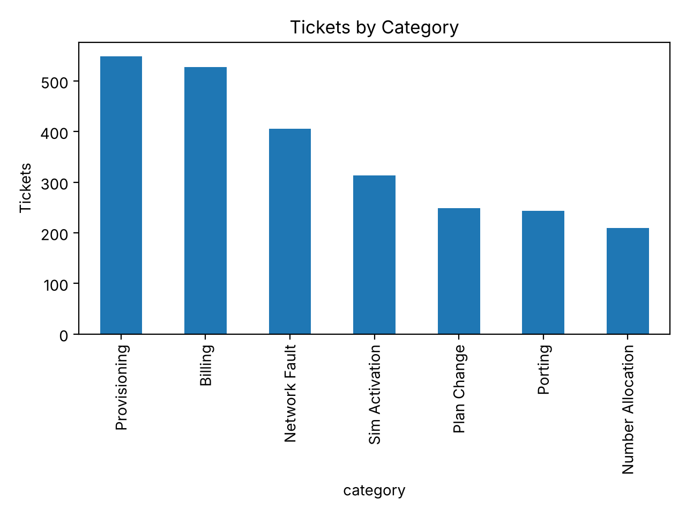
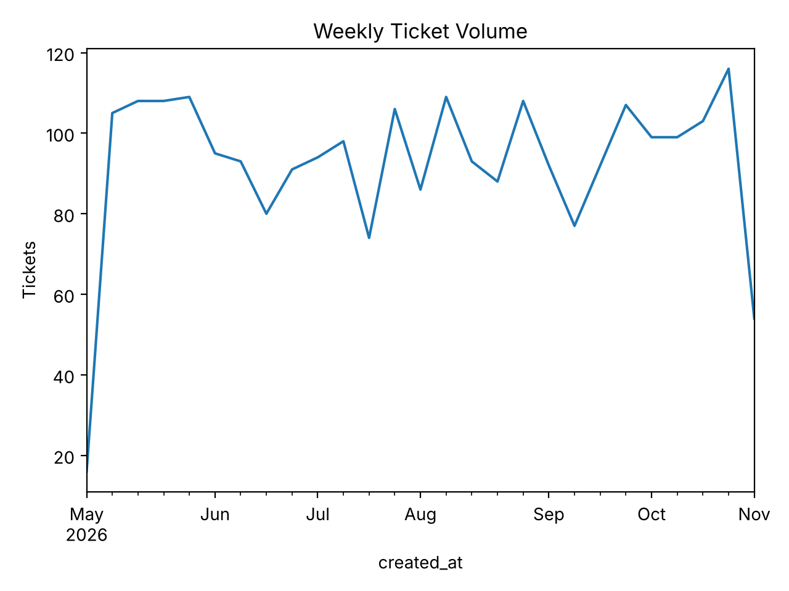
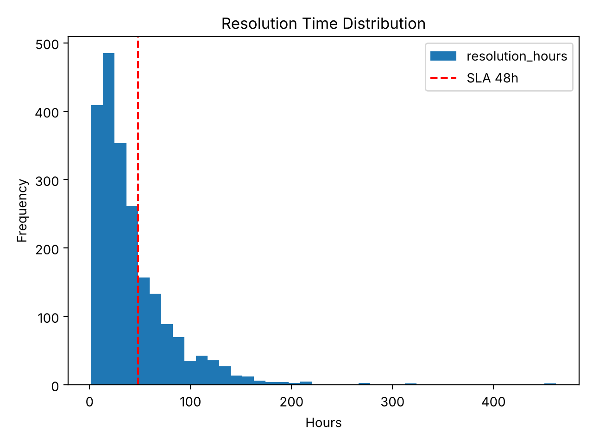
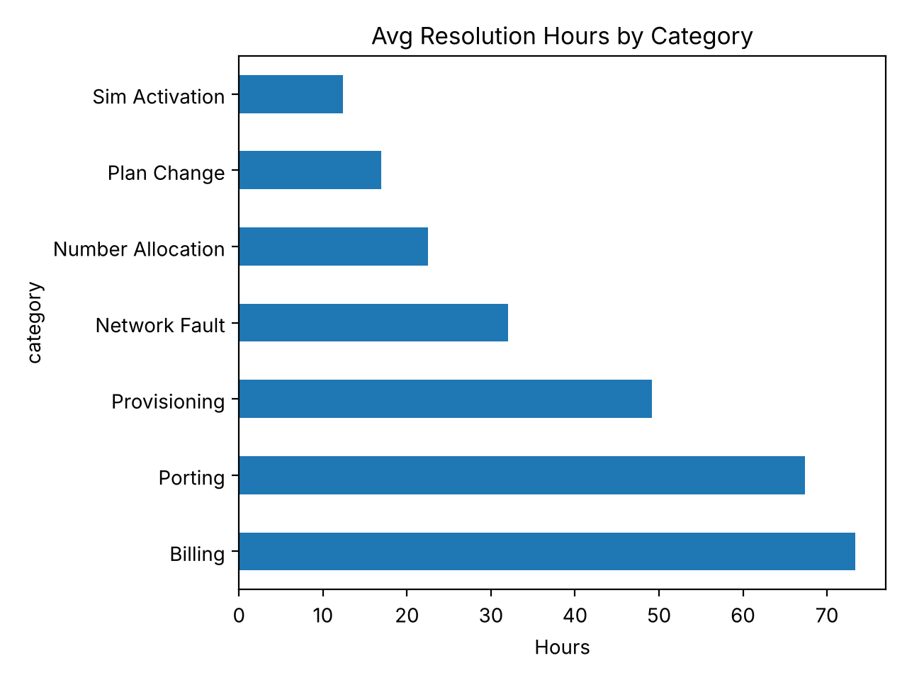

# Telecom Service Ticket Analysis

Python project that cleans and analyzes telecom service-request (ticket) data to find where delays and SLA breaches happen.

> Note: the dataset is **synthetic** (generated by `generate_tickets.py`). No real company or customer data is used.

## Problem
Back-office teams handle thousands of service requests (provisioning, billing, porting, SIM activation, etc.). Which categories are slow, and when does volume peak?

## What this project does
1. Loads 2,540 raw tickets (with duplicates, inconsistent category names, mixed date formats, missing values)
2. Cleans the data with pandas
3. Answers 5 business questions
4. Produces 4 charts

## Key findings
- **SLA breach (>48h): 30.1% overall.** Porting (59.4%) and Billing (59.3%) are the worst; SIM Activation is only 0.4%.
- **Billing averages 73 hours** to resolve, about 6x slower than SIM Activation (12 hours).
- **Mondays have about 2x the volume** of other weekdays (787 tickets vs ~370-410).
- **8 AM is the peak hour** (475 tickets).
- Recommendation: add staff on Monday mornings and strengthen the Billing and Porting teams.

## Charts





## How to run
```bash
pip install -r requirements.txt
python generate_tickets.py     # creates telecom_tickets.csv (optional, file already included)
python ticket_analysis.py      # prints results, saves charts and telecom_tickets_clean.csv
```

## Tech stack
Python, pandas, matplotlib

## Files
| File | Purpose |
|---|---|
| `generate_tickets.py` | Generates the synthetic dataset |
| `telecom_tickets.csv` | Raw (messy) data |
| `ticket_analysis.py` | Cleaning, analysis, charts |
| `chart*.png` | Output charts |
